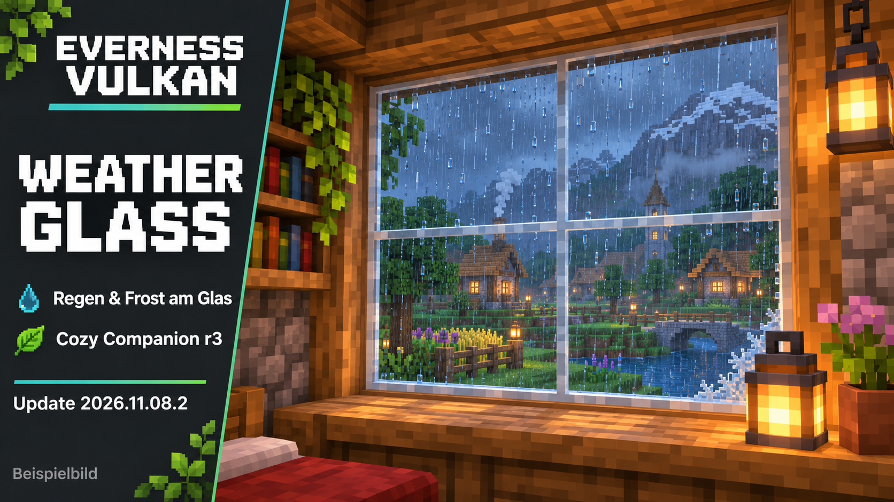

# Everness Vulkan – 2026.11.08.2

Weather Glass für Regen und Frost am Fenster, ergänzt um Cozy Companion r3 mit zwei zusätzlichen Shaderprofilen.

## Neu: Weather Glass und Cozy Companion

Regen und Frost auf Fenstern mit Weather Glass 0.6.0. Leichte Vanilla-Details (16x), normale Regen-/Schneemengen, Beta-Staub/Wind und zusätzlicher Glas-Weichzeichner aus. Konfiguration: **Mods → Weather Glass**.

**Cozy Companion r3** bietet **Cozy - Normal** und **Cozy - Pixelated**. Grundlage ist [Complementary Unbound r5.9.3 von EminGT / Complementary Development](https://www.complementary.dev/). Der separat über Modrinth geladene Originalshader bleibt erhalten. Die MIT-Start-Hilfe erstellt nur auf deinem Rechner die lokale Cozy-Variante und erhält vorhandene eigene Dateien. Keine vollständige geänderte Complementary-Kopie wird hier hochgeladen; [Quellen und Funktionsweise](patches/cozy-companion-setup). Für die Pack-Zusammenstellung und die lokalen Anpassungen ist Everness verantwortlich.

**Prüfstand:** beide Renderer mit geladenem Cozy/Weather Glass jeweils 165 Sekunden in einer Offline-Regen-/Schnee-Szene regulär beendet. Die sichtbare Abnahme ist wegen verweigerter Windows-Fenstersteuerung noch offen. [Details und bekannte Grenzen](PACK-STATUS.md).

Der Stand enthält **68 Mods, 29 Ressourcenpacks, 4 direkt heruntergeladene Shaderarchive und die lokal erzeugte Cozy-Variante**. Shaderwahl, Hotkeys, HUD und andere bestehende Mod-Optionen bleiben erhalten. Eine Neuinstallation benötigt ein eigenes Minecraft-Konto und Java 25.

[Änderungsnotizen](CHANGELOG.md) · [Tatsächlicher Prüfstand und Grenzen](PACK-STATUS.md) · [Einstellungen übernehmen](SETTINGS.md)

## Installieren

- [Prism-Starter herunterladen](downloads/Everness-vulkan-Prism-Starter.zip), als Instanz in Prism importieren und Java 25 verwenden.
- Bei bestehender Installation das Pack aktualisieren. Für den vollständigen Einstellungsabgleich zusätzlich das [Einstellungspaket](downloads/Everness-vulkan-Einstellungen.zip) einmal mit Sicherung anwenden; [Anleitung](SETTINGS.md).
- Das aktuelle Pack enthält **68 Mods, 29 Ressourcenpacks, 4 direkte Shaderarchive plus Cozy als lokale Variante**. [Alle Downloads und Quellen](MODLIST.md).

## Gemeinsame Bedienung

HUD, Jade, Minimap, FOV, Vollbild, Ressourcenpack-Reihenfolge, Punchy-Profil und QoL-Optionen stammen aus derselben Vulkan-Vorlage. **Alt+B** schaltet AutoSwitch um; Tastenkombination und Item-Ausschlüsse sind im Modmenü einstellbar. **Ziffernblock \*** schaltet den Shader, **Ziffernblock +** lädt ihn neu, **O** öffnet die Shaderauswahl. Die Bezeichnungen der Shader-Funktionen werden jeweils an Iris bzw. Vitrail angepasst.

## Grafikkomponenten

Minecrafts eingebauter Vulkan-Renderer, Vitrail 0.13.0-beta mit Everness-Tiefenpufferkorrektur, VIRIS 0.3.6 und Voxy 0.2.20-beta. Voxy bleibt eine separat heruntergeladene offizielle Abhängigkeit. Die Vitrail-Änderung und vollständige Quellen stehen unter [patches/vitrail-depthfix](patches/vitrail-depthfix).

100 % Render-Skalierung ist der veröffentlichte Standard. Ein erfolgreicher Offline-Lauf belegt keine allgemeine Absturzfreiheit. **Zusätzliche native Startabbrüche wurden beobachtet und bleiben offen**; Details und einzelne Ergebnisse stehen im [Prüfbericht](PACK-STATUS.md). Es wurde kein Multiplayer-Server betreten.

Persönliche Konten, Welten, Karten-/LOD-Caches und Logdateien sind nicht enthalten. Lizenzen und Quellen: [THIRD-PARTY.md](THIRD-PARTY.md).
