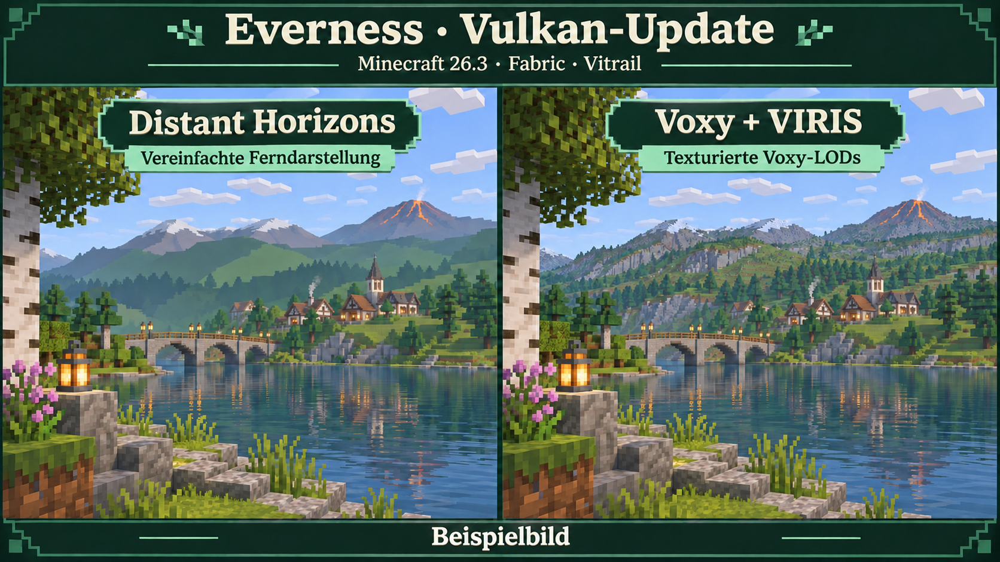

# Everness Visuals — Vulkan

**Minecraft 26.3 · Fabric 0.20.1 · Java 25 · Update 2026.11.07.4**

Das Vulkan-Pack verwendet jetzt **Voxy + VIRIS + Vitrail**. Gemeint ist Minecrafts eingebauter Vulkan-Renderer, **kein VulkanMod**. Distant Horizons ist aus dem aktuellen Installationsstand entfernt.



*Beispielbild: schematische Gegenüberstellung. Keine Spielaufnahme oder FPS-Messung; das tatsächliche Bild hängt von Detailstufe, Shader und Szene ab.*

## Warum Voxy für dieses Pack?

- **Texturierte Fernlandschaft:** Voxy verwendet seinen eigenen texturierten LOD-Renderer. VIRIS führt ihn in einem versteckten OpenGL-Kontext aus und teilt die Ergebnisbilder mit Minecraft-Vulkan.
- **Anbindung an die vorhandenen Shader:** Complementary Reimagined, Complementary Unbound und Photon enthalten Voxy-Patches. VIRIS bindet diese über Vitrail ein, damit die Shader ihre eigenen LOD-Programme für Farbe, Wasser und Nebel verwenden können.
- **Ein Weg für die Ferne:** Dieses Pack verwendet Voxy und entfernt den bisherigen DH-Pfad. Die vom Nutzer getestete Kombination ist damit als gemeinsamer, gepinnter Stand verfügbar.

Das macht Voxy für die gewünschte texturierte Fernsicht in **diesem Pack** passender. Es ist kein allgemeiner Beleg, dass Voxy auf jedem PC schneller oder stabiler als DH ist. VIRIS benötigt zusätzlich Interop; ein kontrollierter FPS-Vergleich mit DH liegt nicht vor. [VIRIS-Implementierung und Grenzen](https://github.com/laurensanp/viris), [Voxy](https://github.com/MCRcortex/voxy).

## Installieren

1. [Aktuellen Prism-Starter herunterladen](https://github.com/Jogurella/everness-vulkan-packwiz/raw/refs/heads/main/downloads/Everness-vulkan-Prism-Starter.zip).
2. In Prism **Instanz hinzufügen → Import aus ZIP** wählen.
3. **Java 25** und das eigene Microsoft-Konto verwenden. Der Starter enthält Fabric **0.20.1** und die Einstellungsdateien; packwiz lädt die Archive mit Prüfsummen nach.
4. Minecraft auf **Vulkan** starten. Shader über Vitrail auswählen. Die übernommene Auswahl ist `Tobias-Pixel.zip`; außerdem sind Reimagined, Unbound und Photon enthalten.

Es erfolgt kein automatischer Serverbeitritt. **Forever Ever Server** ist einmal in der Serverliste eingetragen.

## Bestehende Installation aktualisieren

**Wichtig für ältere Prism-Starter:** Unter **Instanz bearbeiten → Version → Fabric Loader** auf **0.20.1 oder neuer** aktualisieren. packwiz aktualisiert Mods, aber nicht Prisms Loader-Komponente. Im aktuellen Everness-Launcher wird die zu `pack.toml` passende Fabric-Version beim Spielstart vorbereitet.

Die Pack-URL bleibt gleich:

```text
https://raw.githubusercontent.com/Jogurella/everness-vulkan-packwiz/main/pack.toml
```

Der normale packwiz-Update entfernt die bisher verwaltete DH-JAR und ergänzt Voxy und VIRIS. Falls DH außerhalb von packwiz manuell installiert wurde, die zusätzliche DH-JAR aus `mods` entfernen. Persönliche LOD-Daten werden nicht gelöscht oder verteilt.

## AutoSwitch-Erweiterung

Die bisherige Atlas-Inventarsteuerung ist wieder enthalten: **Alt+B** schaltet AutoSwitch um. Unter **Mods → AutoSwitch → Konfigurieren** lassen sich Tastenkombination und Item-Ausschlüsse bearbeiten. Die Zusatzmod enthält außerdem die bisherigen Shulker-Werkzeugfunktionen und AutoTotem-Einstellungen. Die drei zugehörigen Einstellungsdateien werden mitgeliefert. Tobias-Pixel behält seine vier Profile nach dem Speichern; die Profilschreibweise wurde für Vitrail korrigiert.

## Einstellungen, Inhalt und Prüfstand

**66 Mod-JARs, 29 Ressourcenpacks, vier Shaderarchive.** Der Stand übernimmt die gemeinsamen Einstellungen des getesteten VIRIS-Profils: Hotkeys, FOV, HUD, Inventarmods, Punchy, Animationen, Ressourcenpack-Reihenfolge und Shaderwerte. [Einstellungsübernahme](SETTINGS.md) · [Downloads und exakte Quellen](MODLIST.md) · [Prüfstand und bekannte Grenzen](PACK-STATUS.md).

Der Nutzer hat das vollständige Pack als funktionierend zurückgemeldet. Eine vollständige automatische Prüfung aller Shader-/Wasser-/Nebel-/Reload-/Wiedereintrittsfälle und ein Langzeitvergleich sind nicht abgeschlossen. Insbesondere hat VIRIS noch **keine Schatten auf LODs**; Wasserübergänge und hohe Wolken haben dokumentierte Grenzen. Das Beispielbild ist kein Nachweis dieser Funktionen.

Voxy wird **separat direkt vom Autoren-Download** bezogen und nicht in VIRIS oder dieses Repository eingebettet. VIRIS wird als offizieller MIT-Autoren-Build bezogen; die Klassen sind mit dem hier gebauten Teststand identisch. Die AutoSwitch-Zusatzmod entspricht dem bisherigen eigenen Build; bei Tobias-Pixel wurde ausschließlich die Schreibweise der An/Aus-Profilwerte berichtigt. [Herkunft und Lizenzen](THIRD-PARTY.md).
