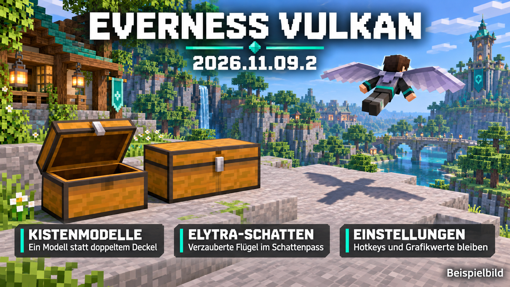
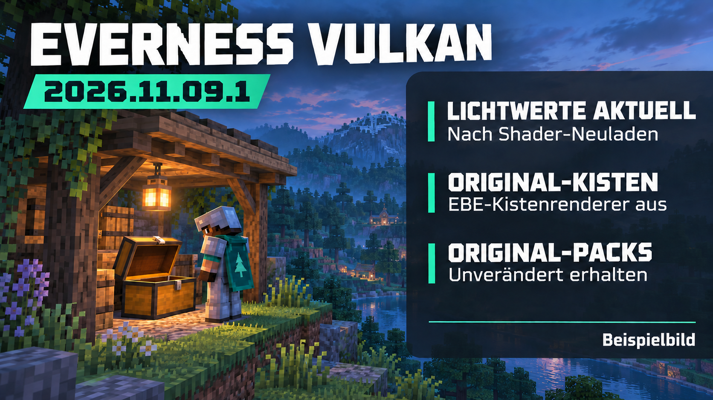
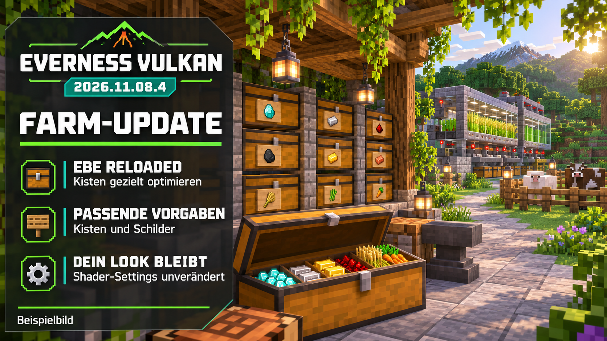
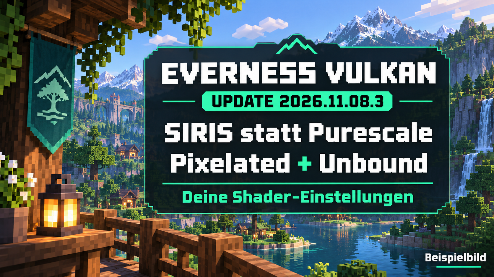

# Everness Vulkan – 2026.11.09.2

## Aktuelles Update: Kisten und Elytra-Schatten

**Die alte persönliche EBE-Kistenoption wird jetzt vor dem Laden der Modelle mit Sicherung korrigiert.** Dadurch greift die Kisten-Kompatibilitätsvorgabe auch bei erhaltenen Einstellungen. Zusätzlich zeichnet Vitrail die Grundtextur verzauberter Ausrüstung im Schattenpass: Der fehlende Flügelschatten ließ sich damit im Offline-Vergleich beheben.

[Änderungen](CHANGELOG.md) · [Echte Kisteninventare und Flugschatten: Prüfbericht](docs/CHEST-ELYTRA-ABNAHME.md) · [Quellcode und Bauanleitung](patches/viris-equipment)

**70 Mods, 29 Original-Ressourcenpacks, Pixelated und Unbound.** Alle 132 Einstellungsvorlagen bleiben bytegleich: Grafik, Shaderdetails, Sichtweite, SIRIS, Hotkeys, HUD und QoL werden nicht reduziert oder umgestellt. Minecraft nach dem Update vollständig neu starten. OpenGL bleibt unverändert.

Die Kistenmigration prüft auf das aktive Objects-Pack, sichert die alte EBE-Datei unter `.everness/compat-backups/` und läuft pro Installation nur einmal. Die normale Darstellung der verzauberten Elytra behält ihren Glanz. Kein vollständiger Fix aller Server-Capes, Rüstungsflacker-Ursachen, LOD-Bergschatten oder Laptopabstürze; die Grenzen stehen im Prüfbericht.

## Vorheriges Update 2026.11.09.1: Lichtzustand und Original-Kisten

**VIRIS mit gezielter Lichtkorrektur:** Nach Shader-Neuladen und Weltwechsel liest Voxy den aktuellen Vitrail-Zustand. Die Kistenvorgabe schaltet EBE-Kistenmodelle aus, damit die vorhandenen Originalmodelle zuständig bleiben. Schilderoptimierung, Animationen und Ressourcenpacks bleiben erhalten.

[Änderungen](CHANGELOG.md) · [Tatsächliche Tests und offene Punkte](docs/VISUAL-FIX-ABNAHME.md) · [Eigener VIRIS-Patch und Bauanleitung](patches/viris-lifecycle)

**70 Mods, 29 unveränderte Ressourcenpacks, Pixelated und Unbound.** Alle bisherigen Grafik-, Shader-, Sichtweiten-, FOV-, HUD-, Hotkey- und QoL-Dateien bleiben erhalten; ausschließlich der EBE-Kistenschalter ändert sich in der Vorlage. Update und Minecraft-Neustart erforderlich. Wer persönliche Einstellungen erhält, kann den Kistenschalter in Mod Menu selbst ausschalten.

Das Update ist **kein vollständiger Schatten-/Rüstungs-/Laptop-Crash-Fix**. Vollständige Fernberg-Schatten sind weiterhin eine VIRIS-Grenze. Eine zusätzliche Schattenanbindung mit auffälliger Modellgeometrie wurde bewusst nicht freigegeben; der Prüfbericht unterscheidet getestete Funktionen und offene Fehler.

## Vorheriges Update 2026.11.08.4: Kistenoptimierung

**EBE Reloaded 0.13.3 + MatLib 1.0.0** ergänzen den bestehenden nativen Vulkan-/Vitrail-/VIRIS-/Voxy-Aufbau. Kisten und Schilder werden gezielt optimiert. Deine bisherigen Shader-, Sichtweiten-, SIRIS-, HUD- und Hotkey-Einstellungen bleiben erhalten. **70 Mods, 29 Ressourcenpacks, Pixelated und Unbound.**

[Aktuelle Änderungen](CHANGELOG.md) · [Tests und Einschränkungen](docs/FARM-PERFORMANCE-ABNAHME.md)

EBE lässt sich in Mod Menu pro Blocktyp abschalten. Kisten behalten das Öffnen/Schließen, benutzen aber EBE-Modelle; zusätzliche Objektanimationen sind nicht garantiert identisch. Keine garantierten FPS-Zahlen. VulkBatch ist nach der Quellprüfung nicht enthalten.

## Bisherige Shader-Einrichtung

Zwei Shader mit deinen Einstellungen: **Pixelated** und **Complementary Unbound r5.9.3**.

**SIRIS 1.1.6** ersetzt Purescale. Vorgabe: **Custom 100 %**, DLAA-NGX-Modus, Modell M, **2× Frame Generation** auf RTX 40/50; keine reduzierte interne Auflösung angefordert. Die SIRIS-Option `disablePackTaa=true` schaltet das doppelte Shader-TAA ab.

[Änderungsnotizen](CHANGELOG.md) · [Prüfbericht](docs/SIRIS-SHADER-ABNAHME.md) · [Einstellungen](SETTINGS.md) · [Downloadliste](MODLIST.md)

## Aktualisieren

Im Everness Launcher das Vulkan-Pack aktualisieren und Minecraft neu starten. Alte Shader werden beim ersten Start außerhalb der aktiven Liste gesichert. Die beiden mitgelieferten Einstellungsdateien werden einmal übernommen; spätere eigene Änderungen bleiben erhalten. Wenn bisher ein entfernter Shader ausgewählt war, wird Pixelated gewählt. Ein bereits gewähltes Unbound bleibt aktiv.

**Minecraft 26.3 · Fabric Loader 0.20.1 · Java 25.** Das Pack enthält **70 Mods und 29 Ressourcenpacks**. Ein offizielles Shaderarchiv wird heruntergeladen und ein zweites lokal gepatcht; danach sind genau zwei Shader verfügbar. Keine Welten, Konten oder privaten Karten-/Voxy-Daten enthalten.

## Neuinstallation mit Prism / packwiz

Die Instanz [Everness-vulkan-Prism-Starter.zip](downloads/Everness-vulkan-Prism-Starter.zip) in Prism importieren, Java 25 und dein eigenes Minecraft-Konto auswählen. Der vorkonfigurierte packwiz-Start lädt die gepinnten Dateien. Alternativ pack.toml über packwiz verwenden. Die [Einstellungs-ZIP](downloads/Everness-vulkan-Einstellungen.zip) und `tools/restore-settings.py` sichern und übertragen die veröffentlichten Vorgaben. [Prüfsummen](downloads/SHA256SUMS.txt).

## Shader und Quellen

**Complementary Unbound r5.9.3** stammt von EminGT / [Complementary Development](https://www.complementary.dev/) und wird unverändert über den offiziellen Modrinth-Download bezogen. **Pixelated** basiert darauf sowie auf [Euphoria Patches von SpacEagle17 und Mitwirkenden](https://www.euphoriapatches.com/). Für diese Modpack-Zusammenstellung und lokale Anpassungen ist Everness verantwortlich. Die ursprünglichen Lizenzdateien bleiben im lokalen Ergebnis unverändert enthalten.

Der eigene kleine [Patch-/Migrationshelfer](patches/pixelated-setup) erzeugt Pixelated nur lokal aus dem geprüften Original, sichert alte Shader und stellt die Auswahl um. Er bettet keine Voxy-Mod-JAR und keine vollständige modifizierte Shader-ZIP ein. Seine Java-Quellen stehen unter MIT; Shader-/Patchdaten unterliegen den jeweiligen Shaderlizenzen.

## Prüfstand

EBE-Kandidat und Vergleichskopie haben die kurzen Offline-Abläufe mit beiden Shadern und erneutem Weltbeitritt regulär abgeschlossen; Kisten öffnen und schließen sichtbar. Ein belastbarer FPS-Zuwachs ist nicht nachgewiesen. Der vorhandene Mob-Geometriefehler der künstlichen Tiergruppe und die übrigen Grenzen stehen im [aktuellen Prüfbericht](docs/FARM-PERFORMANCE-ABNAHME.md). Der [frühere SIRIS-Bericht](docs/SIRIS-SHADER-ABNAHME.md) dokumentiert die FG-Einrichtung.
